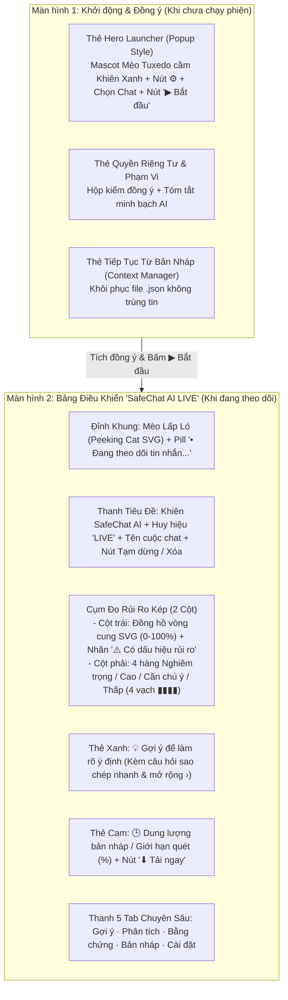

# Phân Tích Kiến Trúc & Thiết Kế Giao Diện SafeChat AI (UI/UX v2)

Tài liệu này tổng hợp toàn bộ cấu trúc kỹ thuật của **SafeChat AI (`v0.4.0`)** (theo [`TAI_LIEU_KY_THUAT.md`](TAI_LIEU_KY_THUAT.md), [`docs/quy-tac-phat-trien.md`](./quy-tac-phat-trien.md), [`HUONG_DAN_CAI_DAT.md`](../apps/extension/HUONG_DAN_CAI_DAT.md)) và thiết kế chi tiết bản nâng cấp giao diện **UI v2** kèm hệ thống chuyển động mượt 60fps.

---

## 1. Các Nguyên Tắc Bất Biến Từ Kiến Trúc Cốt Lõi (Bắt Buộc Tuân Thủ)

Qua rà soát toàn bộ codebase (`src/core/`, `src/background/`, `src/content/`, `src/sidepanel/`, `tests/`), bản thiết kế UI mới tuân thủ tuyệt đối 6 nguyên tắc bất biến của dự án:

1. **Không thao tác giao diện Messenger (`quy-tac-phat-trien.md` §1):**
   - Content script (`src/content/index.ts`) chỉ đọc văn bản của cuộc trò chuyện được chọn, tuyệt đối không chèn phần tử lạ làm biến dạng DOM của Facebook/Messenger. Toàn bộ giao diện mới (gồm cả **Thẻ Khởi Động có Mascot Mèo Khiên** và **Bảng điều khiển `SafeChat AI LIVE`**) được tích hợp hoàn chỉnh trong **Side Panel (`src/sidepanel/`)** và trang xem trước **`/dev/panel-preview.html`**.
2. **An toàn hiển thị — Tuyệt đối không dùng `innerHTML` (`quy-tac-phat-trien.md` §1 & §5.2):**
   - Toàn bộ phần tử HTML và đồ họa vector **SVG (Mascot Mèo cầm khiên, Mèo lấp ló, Đồng hồ vòng cung Radial Gauge, Icon)** đều được dựng bằng hàm tạo phần tử an toàn `h()` và `svg()` (`document.createElementNS('http://www.w3.org/2000/svg', ...)`), gán văn bản qua `textContent`. Không có bất kỳ lệnh `innerHTML`, `outerHTML` hay `insertAdjacentHTML` nào trong `src/`.
3. **Không kết luận tội phạm (`quy-tac-phat-trien.md` §1):**
   - Điểm `0–100` hiển thị trên đồng hồ vòng cung luôn đi kèm chú thích rõ là **"Điểm dấu hiệu"** (không phải xác suất lừa đảo hay xác nhận an toàn). Nhãn cảnh báo dùng *"Có dấu hiệu rủi ro"*, *"Cần chú ý"*, *"Chưa nhất quán"*.
4. **Mức Nghiêm trọng (`safety_priority = true`):**
   - Tự động tắt danh sách câu hỏi thăm dò (`questions = []`), hiển thị nổi bật khung **Ưu tiên an toàn của bạn** (`SAFETY_MESSAGE` cho nguy cơ thân thể/cô lập hoặc `FINANCIAL_SAFETY_MESSAGE` cho bẫy tài chính/mã độc) kèm danh bạ khẩn cấp (`113`, `111`, `canhbao.khonggianmang.vn`).
5. **Bảo toàn 100% 30 mục kiểm thử trong `HUONG_DAN_CAI_DAT.md`:**
   - Giữ đầy đủ chức năng: Chọn 1 trong nhiều khung chat (`threadPicker`), Trạng thái chờ mở lại khung chat (`s.waiting`), Báo chuyển cuộc trò chuyện (`s.pendingThread`), Chống dao động (`stability_note`, `raw_level`, `maxLevel`), Tiến trình kịch bản (`S0–S4`), Sổ đối chiếu phát biểu (`claims`), Đánh dấu tín hiệu (`verified`, `not_relevant`, `review`), Context Manager (`Lưu phiên .json` / `Tiếp tục từ bản nháp`), Xuất báo cáo (`HTML` / `JSON`), và AI phân tầng (`Gemini Nano` + `Groq openai/gpt-oss-120b`).
6. **Cập nhật DOM giữ trạng thái (Stateful DOM Patching):**
   - Khắc phục triệt để nhược điểm của `app.replaceChildren()` cũ: khi đang ở màn hình phiên theo dõi (`Session`), khung DOM chính và đồng hồ SVG được giữ nguyên trên cây DOM và cập nhật thuộc tính mượt mà để hiệu ứng CSS transition & bộ đếm số `requestAnimationFrame` đạt chuẩn 60fps.

---

## 2. Cấu Trúc 5 Khối Giao Diện Chuẩn Theo Mockup

### Chi tiết ánh xạ dữ liệu giữa Logic Core (`src/core/`) và Giao diện mới (`src/sidepanel/`)

1. **Đồng hồ Vòng cung (Radial Arc Gauge) & Con số Điểm Dấu Hiệu:**
   - Góc mở vòng cung `240°` (`stroke-dasharray`), tỷ lệ lấp đầy bằng `s.result.score` (`0` → `100`).
   - Dải màu tự động biến thiên theo `s.result.risk_level`:
     - `low` (**Thấp**, `0–24`): Xanh ngọc `#10b981` — Nhãn: `✓ Chưa thấy dấu hiệu rõ`
     - `attention` (**Cần chú ý / Trung bình**, `25–59`): Vàng hổ phách `#f59e0b` — Nhãn: `ℹ️ Cần chú ý xác minh`
     - `high` (**Cao**, `60–99`): Cam đậm `#f97316` — Nhãn: `⚠️ Có dấu hiệu rủi ro`
     - `critical` (**Nghiêm trọng / Rất cao**, `100`): Đỏ tươi `#ef4444` — Nhãn: `🚨 Rủi ro rất cao — Ưu tiên an toàn`
2. **Thang 4 Mức Rủi Ro (4-Tier Capsule Meter Bars):**
   - Hiển thị 4 hàng: **Rất cao (Nghiêm trọng)**, **Cao**, **Trung bình (Cần chú ý)**, **Thấp**.
   - Mỗi hàng có 4 vạch capsule (`▮▮▮▮`). Số vạch sáng lên ở từng hàng được tính tự động từ `s.result.score` và số lượng tín hiệu (`s.result.signals`) ở mức tương ứng, đồng thời hàng khớp với `s.result.risk_level` hiện tại sẽ được bọc nền highlight nổi bật.
3. **Thẻ `💡 Gợi ý để làm rõ ý định`:**
   - Hiển thị trực tiếp các câu hỏi gợi ý từ `s.result.advice.questions` (có nút chép 1 chạm) và các khuyến nghị từ `s.result.advice.actions`. Bấm vào mũi tên `›` ở góc phải sẽ chuyển mượt sang tab `Bằng chứng` (hoặc mở rộng danh sách).
4. **Thẻ `🕒 Giới hạn quét & Sao lưu nhanh` (`⬇ Tải ngay`):**
   - Tính phần trăm `pct = Math.round((s.transcript.messages.length / s.maxMessages) * 100)`.
   - Khi `pct >= 80%` sẽ hiển thị cảnh báo *"Gần đến giới hạn quét (`pct`%)"* như ảnh mẫu; khi `< 80%` hiển thị thanh trạng thái bộ nhớ phiên kèm nút **`⬇ Tải ngay`** để người dùng tải nhanh file lưu phiên Context Manager (`.json`) hoặc báo cáo HTML bất cứ lúc nào.

---

## 3. Hệ Thống Chuyển Động Mượt Mà (60fps Motion System)

- **Chuyển động vòng cung & đếm số (`animateGauge`):** Lưu `lastAnimatedScore` trong bộ nhớ giao diện; khi `score` thay đổi, chạy `requestAnimationFrame` với hàm nội suy `easeOutCubic` trong `650ms` để số phần trăm nhảy mượt từng đơn vị đồng bộ với vòng cung SVG.
- **Linh vật Mèo Tuxedo (`createLauncherCatSvg` & `createPeekingCatSvg`):** Đồ họa vector SVG thuần có hiệu ứng nhịp thở nhẹ (`@keyframes floatBreathe`), chớp mắt tự nhiên (`@keyframes catBlink`), và đôi bàn chân trắng bám mép trên thẻ `SafeChat AI LIVE`.
- **Hiệu ứng Sáng vạch Tuần tự (`Staggered Segments`):** 4 vạch capsule ở mỗi hàng có `transition-delay` tăng dần (`0ms`, `60ms`, `120ms`, `180ms`), tạo cảm giác sóng năng lượng khi mức độ rủi ro tăng lên.
- **Tôn trọng Trợ năng (`prefers-reduced-motion`):** Tự động tắt hiệu ứng nhấp nhô/chuyển động dài nếu người dùng bật chế độ giảm chuyển động trên hệ điều hành.
